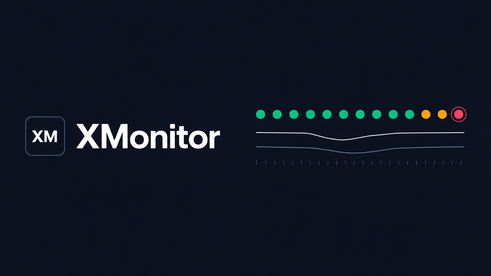

<p align="center">
  
</p>

<p align="center">
  <a href="README.md">English</a>
  &nbsp;·&nbsp;
  <a href="README.zh-CN.md">简体中文</a>
</p>

<h1 align="center">XMonitor</h1>

<p align="center">
  Whether the service still answers, and whether the model is still fast enough to use.
</p>

XMonitor is a self-hosted availability console. It probes the systems you register and the language-model channels you depend on, then keeps status, latency, and alerts on one desk.

Two kinds of checks.

**Systems.** API monitors speak HTTP. Page monitors drive a local Chromium, and can carry an access token or sign in through SSO when the target sits behind a login. A check can be marked expected-down: if that URL starts answering, it is the failure. Use it when you need to confirm something stayed closed.

**Models.** A channel is one gateway: shared base URL and key, many models underneath. Each probe records latency, time to first token, and tokens per second. A failing channel backs off instead of being hammered.

The console has a dashboard, an alert list, a wall display, and a system ledger. The ledger keeps the asset side of a system: the operating unit, IP, OS and version, server sizing (CPU / memory / disk), whether it is wired to campus SSO, ops type, backup notes, whether it is reachable from the internet, whether a domain was applied for, and where the machine physically sits. Choosing "yes" for the domain forces a domain value; choosing "no" leaves it empty and clears any stored value. An entry can be linked to the monitor that watches it, but the two are independent records. Access is split across admin, operator, and viewer, with a permission matrix you can edit. Accounts can be disabled, live sessions listed and revoked, and every identity change lands in an audit log. Configuration and history live in SQLite. Point `XMONITOR_VM_URL` at VictoriaMetrics when you want the longer series there; without it, series stay in SQLite and the console still runs.

The UI updates over a WebSocket. Alerts can leave through a webhook: generic JSON, DingTalk, or WeCom.

## Run it

Docker is the path for a machine that should just stay up. The npm workspace is the path for changing the code.

### Docker

Docker Engine and Compose v2.

```bash
docker compose up -d --build
```

Open [http://127.0.0.1:8790](http://127.0.0.1:8790).

The console listens on port 8790. VictoriaMetrics stays on the container network and is also published at `127.0.0.1:8428` so you can query it from the host. The image starts Chromium and exposes its debugging port only on `127.0.0.1:9222` inside the container. Page checks use that browser.

The database is written to `./data`. Metric blocks are written to `./vm-data`. Both directories are created on the host and stay out of git.

When outbound model calls must pass through a proxy, copy the example and fill it in. Compose reads `.env` from this directory. Empty values mean a direct connection.

```bash
cp .env.example .env
```

### From source

Node.js 20 or newer.

```bash
npm install
npm run dev
```

| Surface | Address |
| --- | --- |
| Console | http://localhost:5173 |
| API and WebSocket | http://127.0.0.1:8790 |

`npm run dev` starts the API and the Vite dev server together. The dev server proxies `/api` and `/ws` to port 8790.

Page checks need Chromium or Chrome listening for DevTools on port 9222. API checks and model probes do not. The Docker image starts that browser for you. Locally:

```bash
# macOS (--no-proxy-server: campus sites go direct, ignore system Clash)
"/Applications/Google Chrome.app/Contents/MacOS/Google Chrome" \
  --headless=new --disable-gpu --no-proxy-server \
  --remote-debugging-address=127.0.0.1 \
  --remote-debugging-port=9222 \
  about:blank
```

```bash
# Linux
chromium --headless=new --disable-gpu --no-proxy-server \
  --remote-debugging-address=127.0.0.1 \
  --remote-debugging-port=9222 \
  about:blank
```

The default endpoint is `ws://127.0.0.1:9222/devtools/browser`. If your browser should be discovered over HTTP, set `XMONITOR_OBSCURA_ENDPOINT` to `http://127.0.0.1:9222`, or change the same value in Settings.

To serve a production build from the API process:

```bash
npm run build
npm start
```

Then open [http://127.0.0.1:8790](http://127.0.0.1:8790). Leave `XMONITOR_VM_URL` unset and series stay in SQLite. To attach VictoriaMetrics, set it to `http://127.0.0.1:8428`.

## First sign-in

An empty database creates one administrator.

| | |
| --- | --- |
| Username | `admin` |
| Password | `admin123` |

Change it from the account menu before the port is reachable by anyone else. The seed runs only while the user table is empty, so an existing `./data` directory keeps the accounts already in it.

## Configuration

| Variable | Default | Role |
| --- | --- | --- |
| `PORT` | `8790` | API listen port |
| `XMONITOR_OBSCURA_ENDPOINT` | `ws://127.0.0.1:9222/devtools/browser` | Chromium DevTools endpoint for page checks |
| `XMONITOR_VM_URL` | unset | VictoriaMetrics base URL. Unset keeps series in SQLite |
| `HTTP_PROXY`, `HTTPS_PROXY`, `NO_PROXY` | unset | Node outbound only (e.g. LLM); Chromium always goes direct. Put campus domains in `NO_PROXY` |

Intervals, timeouts, the slow threshold, the webhook, and SSO credentials are edited in Settings after sign-in. Secret values are masked in API responses.

## Layout

```text
server/   API, scheduler, checkers, SQLite
web/      React console
docker/   container entrypoint
data/     runtime database, created locally, not committed
```

Accounts, tokens, probe history, and `.env` stay on the machine that runs XMonitor. The repository ships code and an empty environment example.
